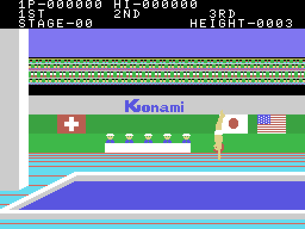
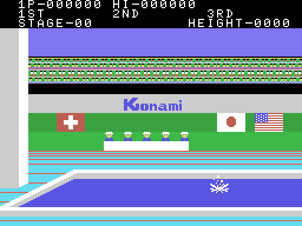
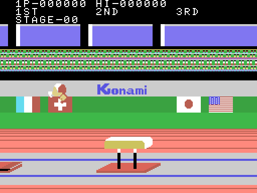
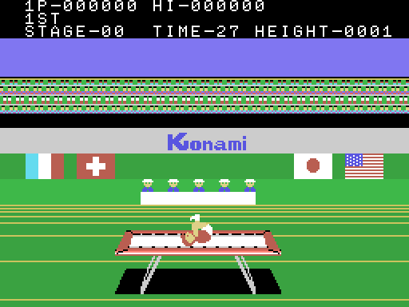
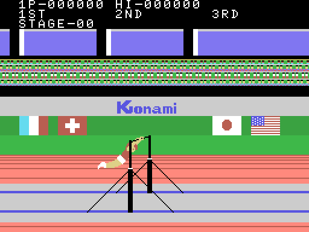

# The game

Hyper Sports 1 is the gymnastics-and-diving half of Konami's Hyper Sports,
converted to the MSX. It has **four events**, and the order they are played in
comes from the four-pointer table at 0x6F00, which 0x6E38 indexes with
`0xE052 and 3`:

| `0xE052 and 3` | event | label script |
|---|---|---|
| 0 | DIVING (springboard) | 0x6F08 |
| 1 | LONG HORSE | 0x6F1E |
| 2 | TRAMPOLINE | 0x6F11 |
| 3 | HORIZONTAL BAR | 0x6F2B |

The texts, on the other hand, sit back to back from 0x6F08 in a different order:
DIVING, TRAMPOLINE, LONG HORSE, HORIZONTAL BAR. Anyone reading the texts instead
of the table gets **the second and the third swapped**.

0xE052 is not reset between rounds: it keeps climbing, and the event comes from
its two low bits, so the fifth is DIVING again with `STAGE` gone up.

## The four screens

These five images are not screenshots. The drawings —patterns and colours— come
from the ROM, decompressed with the same format the Z80 runs at 0x440D; the tile
map and the sprites come from the MSX's VRAM, because **an event's screen is
stored nowhere in the cartridge**: DIBUJA_MARCO (0x4816) only uploads the
drawings, and the map is composed by the engine as it runs.

Before drawing anything, `tools/escenas.py` checks what it pulls from the ROM
against that VRAM. Across the five scenes: **0 differing bytes**.

Of the four, only TRAMPOLINE has a `TIME` readout: its label script (0x4560) is
the only one that writes that word, and it is dumped for that event alone.

## Taking turns

Two players play in turn. The state of the current attempt lives at 0xE050 for
player 1 and at 0xE080 for player 2; when the turn changes, 0x413E swaps the two
blocks whole, so the rest of the code never has to know whose go it is. The word
QUALIFY, drawn from the label at 0x6F45, marks passing to the next round.

## An attempt

Each event is a run-up or a wind-up, a jump or a routine, and a judged result.
The athlete's figure is assembled from tiles and sprites and uploaded each frame;
the judge (0x7859) scores the attempt and decides whether it qualifies, and a
bonus (0x7ABE) is added at the end.

## The athlete's frames

The athlete's drawings are 3,425 bytes —a fifth of the cartridge— in the block
from 0x53EC to 0x614C, cut into **52 strips**. The general decompressor never
touches them: DIBUJA_ATLETA reads them with one of its own (0x69FE), in which the
top bit means the opposite, and which pushes the bytes to the VDP port without
going through the BIOS.

Measuring in openMSX which addresses each event reads over the whole attract
sequence —679,198 reads in 230 emulated seconds— gives the split:

| event | strips touched |
|---|---|
| DIVING | 20 |
| LONG HORSE | 30 |
| TRAMPOLINE | 13 |
| HORIZONTAL BAR | 30 |

Nine strips are used by all four events, seven belong to HORIZONTAL BAR alone,
three to DIVING alone, and eleven are touched by nobody in the attract mode.
